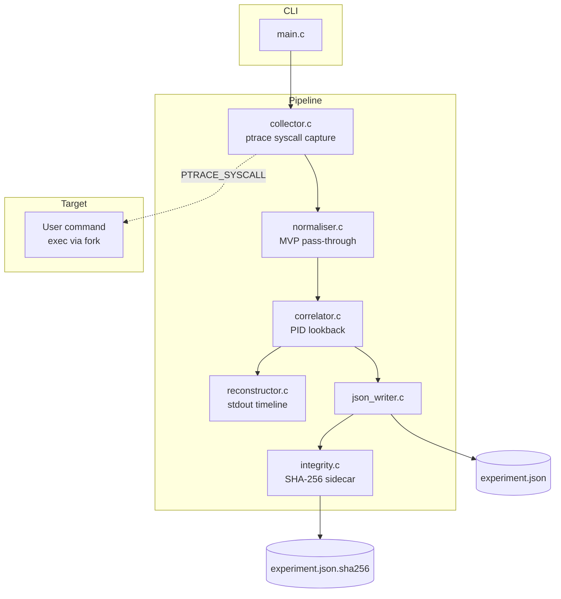
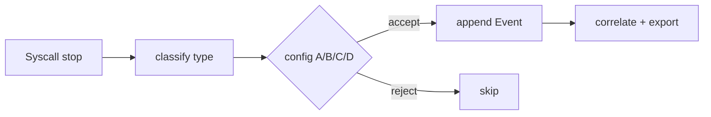

# ForensicTrace — system design (prototype)

## High-level architecture



## Module interaction

| From | To | Data |
|------|-----|------|
| `main.c` | `collector.c` | argv, `FTContext` |
| `collector.c` | memory | `Event[]`, timestamps, syscall metadata |
| `correlator.c` | memory | `parent_event[]` indices |
| `reconstructor.c` | stdout | formatted timeline |
| `json_writer.c` | disk | JSON experiment file |
| `integrity.c` | disk | hash sidecar |

## Evidence configuration flow



## CLI data flow

```
forensictrace --config B --output run.json -- <command>
        │
        ├─► stderr: run metadata
        ├─► stdout: reconstructed timeline
        └─► files: run.json, run.json.sha256
```

Figures in the capstone report (Figures 3–8) match this structure; use terminal
screenshots of the running CLI as **interface evidence** for submission.
