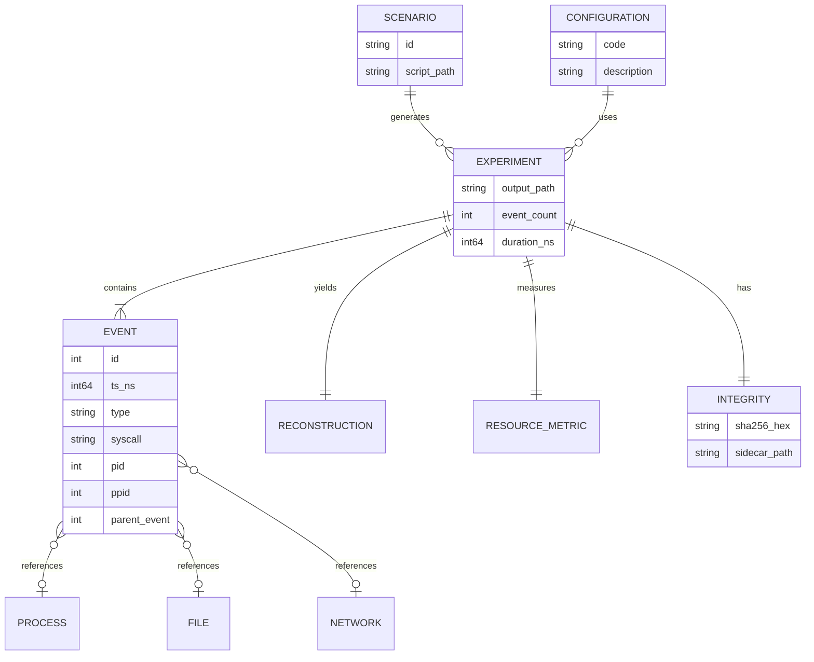

# ForensicTrace — experimental data model (ERD summary)

Logical entities for stored experiments (JSON + manifest), aligned with capstone Figure 4.

**MVP implementation:** One JSON file embeds `config`, `event_count`, `duration_ns`, and
`events[]`. `parent_event` is filled by the correlator. `INTEGRITY` is stored as a separate
`.sha256` file, not inside JSON.
